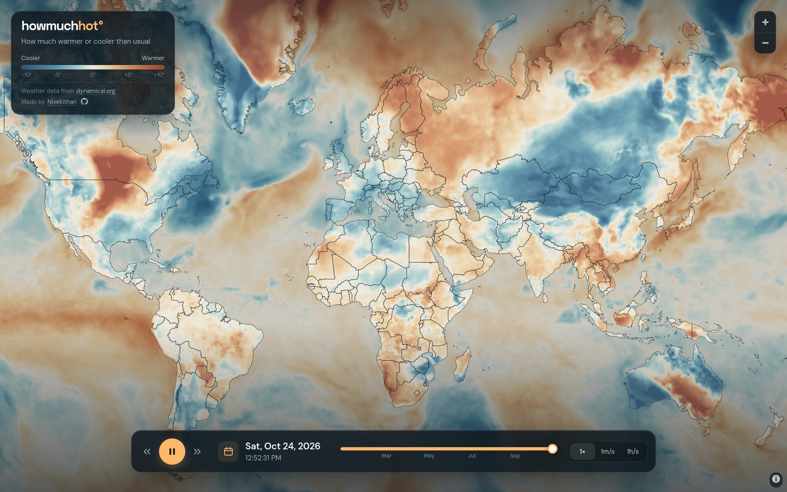

# howmuchhot

See how much warmer or cooler than usual it is, anywhere in the world.

Live site: **[howmuchhot.com](https://howmuchhot.com)**



## What it shows

- The map is coloured by how far today's temperature is from normal.
- **Blue** means cooler than usual. **Orange and red** mean warmer than usual.
- "Usual" means the average temperature at the same date and hour over the past 5 years.
- Use the play button, the date picker or the slider to move through time.
- There is one map for every hour since January 1, 2026. New hours are added a few times a day.

## Where the data comes from

The temperatures come from NOAA's GFS weather model, through
[dynamical.org](https://dynamical.org/catalog/noaa-gfs-analysis-virtual/)
(licensed CC BY 4.0).

## How the project is set up

| Folder            | What it does                                                                 |
| ----------------- | ---------------------------------------------------------------------------- |
| `apps/web`        | The website: the map and the time controls.                                  |
| `apps/worker`     | A Cloudflare Worker. It serves the site and map tiles and starts data updates. |
| `apps/processor`  | Python code. It downloads the weather data and turns it into map tiles.      |
| `packages/tiles`  | Shared code for reading and writing map tiles.                               |
| `packages/utils`  | Small shared helpers.                                                        |

## Run it on your computer

You need Node.js 22.18 or newer and [pnpm](https://pnpm.io).

```bash
pnpm install
pnpm dev
```

To load weather data while `pnpm dev` is running, open another terminal and run:

```bash
pnpm weather:refresh
```

## Check before you push

```bash
pnpm ready
```

This runs the checks and builds every package. GitHub Actions runs the same
checks on every pull request, and deploys to production when `main` changes.

## Made by

[Nivekithan](https://nivekithan.com)
